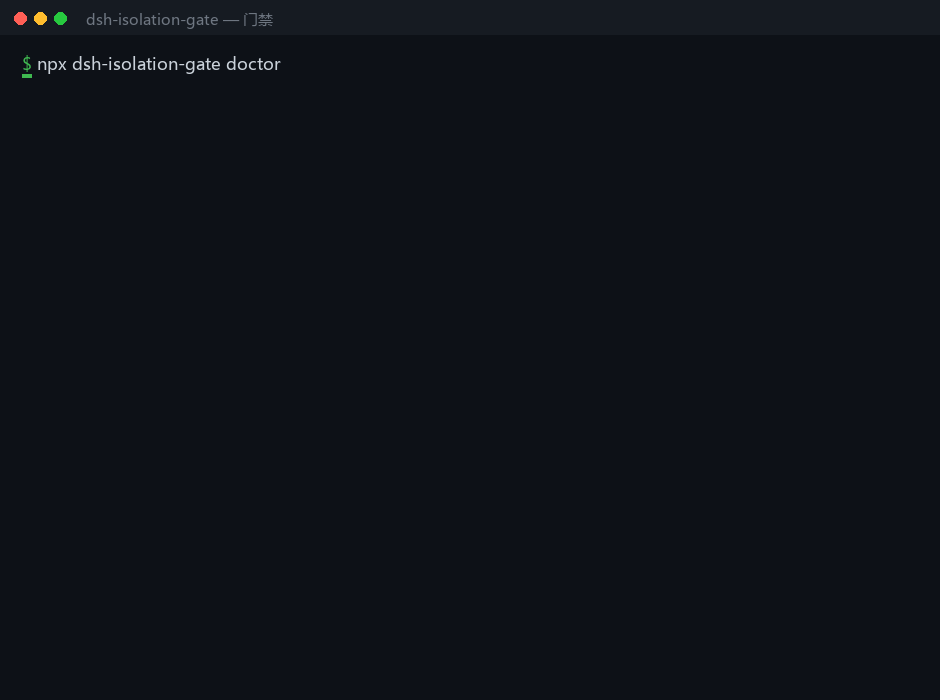

# Access Gate · dsh-isolation-gate

> An **isolation-zone authorization console** for DeepSeek Harness (DSH):
> one screen that answers "which directories on this machine are managed, what level does each have,
> who changed it, and how can the agent check it itself?" — **default-deny**, **roster-based**,
> **group batch switching**, **auditable**, **agent-readable**.

[中文 README](./README.md)

---




## Quick start (3 commands)

```bash
npx dsh-isolation-gate doctor --fix   # wire the harnesses it can find
npx dsh-isolation-gate doctor         # expect 7/7
npx dsh-isolation-gate ui             # flip levels on one screen
```

Changing a level is a UI action (`gate ui`, or the Gate panel inside DSH). The `gate` CLI is the *governed channel* — it judges and reads/writes/deletes under the current policy; it does not grant anything.

## Verified, not claimed

| Check | Result |
|---|---|
| Local test suite | 15/15 suites pass |
| `npm run verify:install` | packs the repo, installs into an empty temp dir, then `doctor` 0/7 → `doctor --fix` 7/7 → re-check 7/7 |
| CI | Ubuntu / macOS / Windows × Node 20 / 22 / 24 |
| Author machine | `doctor` 7/7; the plugin is loaded via a profile `link:` to the repo; a real tool call was denied by it |

Per-harness status lives in [docs/VERIFY.md](docs/VERIFY.md); a one-page walkthrough with real captured output is in [docs/EXAMPLES.md](docs/EXAMPLES.md).

## How it wires into each harness

| Harness | Mechanism | Hard block? |
|---|---|---|
| DSH | native tool guard (`ctx.tools.guard`) | yes |
| Claude Code / ZCode | `PreToolUse` hook | yes |
| Gemini CLI | `BeforeTool` hook | yes |
| opencode | in-process plugin | yes |
| pi | extension `tool_call` | yes |
| Codex CLI | MCP server | no — advisory |
| Cursor / Windsurf | MCP server | no — advisory |

**Honest limits:** anything that only speaks MCP can be *asked* to respect the gate but cannot be *stopped*. opencode and Gemini are wired and unit-tested but have not been run through a full logged-in session.

---

## What it is (and is not)

It is not another allow/deny rule engine, and it is not a sandbox.

- Others ask **"how do I let the agent reach more directories?"** (multi-root / allowlist / write-protect)
  or **"how do I block tools with rules?"** (permission-rules / safety-net).
- **We ask: which directories are off-limits, what level each has, who changed it, and how does the agent check it?**

So the product is the **management surface**:

| Capability | Detail |
|---|---|
| **Three levels** | `deny` (default) / `read` (read-only) / `full` (read-write-delete) |
| **Two object kinds** | **Name** (first-level directory under the drive root, e.g. `Zcode`) or **any absolute path** (e.g. `<drive-root>\Zcode`, `E:\data\shared\project`) |
| **Default deny + roster** | Only objects in the roster are managed; everything else is out of scope; new objects start at `deny` |
| **One-screen switches** | A **segmented control** per object; changes persist immediately and survive restarts |
| **Groups** | Named groups ("harness isolation", "cross-agent sharing"); one click applies a level to the whole group; groups live in the state file, the roster stays one-object-per-line |
| **Folder picker** | Uses the host's native directory picker when available; otherwise falls back to "unlisted first-level directories + path input" |
| **Two enforcement points** | ① the governed channel `bin/gate.mjs`; ② the host **tool pre-execution guard** `ctx.tools.guard()` |
| **Audit** | `~/.dsh/dsh-isolation-gate/access-log.jsonl`: time / object / level / op / allowed / reason only — **never file contents** |
| **Agent self-check** | `node bin/gate.mjs status` — the model can read the policy instead of guessing |

---

## Where it blocks

```
model issues a tool call
   │
   ├─ tools/pre-execute  ← ★ tool guard (this plugin's ctx.tools.guard)
   │      file-tool arguments / shell command text → three-level decision → denial reason returned to the model
   │
   ├─ tool actually executes (read / write / edit / bash …)
   │
   └─ bin/gate.mjs  ← ★ governed channel (agent explicitly reads/writes managed objects through it)
          denied ⇒ not a single byte is touched
```

Both paths call the **same** `checkAccess`, so the panel, the CLI, and the tool guard cannot disagree.

---

## Install

### A. `dsh plugin add` (recommended)

```bash
dsh plugin --profile desktop add dsh-isolation-gate
```

> On the desktop build you can also use **Plugins → Add plugin** and enter the package name or a local path.

### B. profile `link:` (development / local use)

```jsonc
// ~/.dsh/profiles/<profile>/package.json
"dependencies": { "dsh-isolation-gate": "link:D:/plugins/dsh-isolation-gate" }
```

```yaml
# ~/.dsh/profiles/<profile>/cordis.patch.yml
- insert:
    - id: isolation-gate
      name: 'dsh-isolation-gate'
```

⚠️ **Changing the composition requires a dsh restart.** Switching levels or editing the roster does **not**.

### Defaults

| Config | Default | Meaning |
|---|---|---|
| `statePath` | `<data-root>/isolation-gate/state.json` | single source of truth |
| `rosterPath` | `<data-root>/isolation-gate/roster.txt` | roster, one object per line |
| `backupDir` | `<backup-dir>` | backup before roster edits |
| `root` | `<drive-root>\` | root whose first-level directories are listed |
| `auditPath` | `~\.dsh\dsh-isolation-gate\access-log.jsonl` | audit log |
| `toolGate` | `true` | false = channel-only enforcement |
| `suspectVocabulary` | built-in `['pi','codex',…]` | extra "suspected harness directory" names (legacy `harnessVocabulary` still read) |

---

## State file (v3)

```jsonc
{
  "version": 3,
  "defaultLevel": "deny",
  "groups": { "harness isolation": { "note": "", "updatedAt": "…" } },
  "objects": {
    "Zcode": { "level": "deny", "note": "", "group": "harness isolation", "updatedAt": "…" },
    "E:\\data\\shared\\project": { "level": "read", "note": "", "group": "", "updatedAt": "…" }
  },
  "profiles": { "strict-delivery": { "mode": "allowlist", "allow": [{ "path": "E:\\data\\shared", "level": "read" }], "network": "deny", "unknownTool": "deny" } },
  "sessionOverrides": { "<sessionId>": "strict-delivery" }
}
```

- **Legacy formats stay readable**: v1 `harnesses: { key: { level } }` and v2 `objects` are normalised to v3 on read
  (**levels are preserved**; `profiles` / `sessionOverrides` default to empty); the next write persists v3.
- Missing file = **deny everything**; corrupt JSON = **deny everything and never overwrite it**.
- No BOM; writes go through temp-file + rename (atomic).
- `state.harnesses` remains a read-only in-memory alias; it is no longer written to disk.

---

## Decision semantics

1. For a path, compute the **real path** first (realpath of the target, or "deepest existing ancestor realpath + remainder") — junctions cannot smuggle you in;
2. Find the **longest path-segment prefix** among path objects (case-insensitive; `<drive-root>\a\b` does not match `<drive-root>\a\bc`);
3. If no path object matches, fall back to the **first segment under the drive root** against name objects;
4. If nothing matches, the object is **not managed** and this channel allows it;
5. **Roster missing / unreadable ⇒ deny everything** (fail-closed), never "allow all".

---

## Tool guard (`ctx.tools.guard`)

- Covers `read / read_image / grep / glob / write / edit / str_replace_editor / apply_patch / mkdir / move / copy / delete / bash / pwsh / …`
- Shell commands are lexically decomposed: `cd` + relative paths, redirections, pipelines and `bash -c "…"` are followed;
- Unknown commands that mention a managed absolute path are treated as **writes** (allowed only at `full`) — false denials are preferred to false allows;
- If the guard itself throws, it **fails closed**;
- Calls to `bin/gate.mjs` itself are **exempt** (the channel performs its own check; otherwise it would double-block).

---

## CLI

```bash
node bin/gate.mjs status
node bin/gate.mjs policy
node bin/gate.mjs check  --name Zcode --op read
node bin/gate.mjs check  --path "<drive-root>\Zcode\some-file" --op delete
node bin/gate.mjs traverse --path "<drive-root>\Zcode"
node bin/gate.mjs read   --path "<drive-root>\Zcode\some-file"
node bin/gate.mjs write  --path "<drive-root>\Zcode\some-file" --text "content"
node bin/gate.mjs delete --path "<drive-root>\Zcode\some-file"   # backed up to the recycle bin first
node bin/gate.mjs rmdir  --path "<drive-root>\Zcode\empty-dir"   # empty directories only, never recursive
node bin/gate.mjs log    --limit 20
```

**Exit codes**: `0` allowed / success · `3` denied (reason on stderr) · `2` usage or environment error.

---

## HTTP routes

| Method | Path | Purpose |
|---|---|---|
| GET | `/__dsh-isolation-gate/ping` | identity + route list + capabilities (`toolGate` / `picker`) |
| GET | `/__dsh-isolation-gate/state` | full state (roster / levels / groups / diffs / audit / policy lines) |
| POST | `/__dsh-isolation-gate/level` | `{ name, level }` |
| POST | `/__dsh-isolation-gate/roster` | `{ action:'add'\|'remove', name }` |
| POST | `/__dsh-isolation-gate/group-level` | `{ group, level }` |
| POST | `/__dsh-isolation-gate/group` | `{ action:'assign'\|'delete', name?, group }` |
| POST | `/__dsh-isolation-gate/prune` | remove orphan state keys |
| POST | `/__dsh-isolation-gate/pick` | native directory picker (400 when unavailable) |
| POST | `/__dsh-isolation-gate/toolcheck` | `{ tool, args }` dry-run of the tool guard |
| POST | `/__dsh-isolation-gate/check` | `{ name?\|path?, op }` |
| GET | `/__dsh-isolation-gate/log?limit=` | recent audit |

External `Origin` → 403; wrong method → 405; bad JSON / invalid level → 400.

---

## How it relates to other plugins

| Plugin | Scope | Relationship |
|---|---|---|
| `dsh-house-guard` (built-in here) | **System assets**: a fixed set of protected paths writable only by whitelisted butler sessions | Different purpose, disjoint objects; whichever denies wins |
| `PerryLink/dsh-permission-rules` | Rule engine: allow/deny/ask + tool params / shell / network | **Complementary**: it has no read-only level; we never write its YAML and do not depend on it |
| `cherrchen/dsh-plugin-multi-root-workspace` | **Adds** extra workspace roots (read-only / read-write) enforced by the kernel sandbox | **Complementary**: it grants, we fence; it is stronger at enforcement, we are stronger at management |
| `azazo1/dsh-write-protect` | Read-only protection inside the workspace + extra writable roots | Complementary; its shell protection has a documented Windows gap |

> This plugin declares **no `@deepseek-ai/dsh*` peer dependencies** — a DSH upgrade cannot silently disable it through the compatibility-exemption gate.

---

## The 1.0 stability promise

From 1.0 onward, the surfaces below **only grow, never break**. A breaking change would ship as 2.0 with a migration note.

| Surface | Promise |
|---|---|
| **State file** | On-disk format `v3`; v1 / v2 are read-compatible and upgraded on write, levels preserved. New fields are appended only; existing field meanings do not change. |
| **CLI** | `bin/gate.mjs` subcommands and exit codes (`0` allowed / `3` denied / `2` usage or environment error) are frozen; new flags are additive. |
| **HTTP** | Existing `/__dsh-isolation-gate/*` paths and methods are frozen; new routes are additive. |
| **Decision semantics** | The three levels (deny / read / full), longest-prefix matching, default deny and fail-closed are frozen — changing them would be a different product. |

**Not promised**: panel visuals and copy, and audit-log fields, may evolve; bug fixes are not breaking changes.

## Known boundaries (read this)

1. **Raw filesystem access and separate processes are not blocked.** Any program or script that bypasses DSH tool calls can read/write the disk directly.
2. **Shell scanning is heuristic.** Variable indirection, command substitution, encoding, symlinks and `cmd /c` wrappers can bypass it — the same known limitation as comparable in-process guards.
3. **Not a kernel boundary.** It changes no ACLs and does not take over the sandbox.
4. **The tool guard only covers host tools.** An MCP tool that spawns its own process is constrained only by its argument text.
5. **Windows-first.** Path comparison follows Windows semantics; other platforms are untested.

---

## Tests

```bash
node test/run-all.mjs     # 6 suites · 396 assertions · fully offline
node --check lib/*.js
```

---

## Acknowledgements

- Design inspired by `PerryLink/dsh-permission-rules` (Apache-2.0) and Claude Code `permissions` — **no code or README text was copied**.
- Coexists with `@dsh-external/dsh-house-guard`; see the boundary table above.

## License

MIT · see [LICENSE](./LICENSE).

## Works with every harness

```bash
npx dsh-isolation-gate setup claude   # Claude Code PreToolUse hook (hard block)
npx dsh-isolation-gate setup zcode    # ZCode hook (same protocol)
npx dsh-isolation-gate setup opencode # in-process plugin (hard block)
npx dsh-isolation-gate setup pi       # pi extension (hard block)
npx dsh-isolation-gate setup codex    # MCP server (advisory only: Codex has no pre-tool hook)
npx dsh-isolation-gate ui             # local settings page: groups + deny/read/full
```

Default state paths follow the OS (`~/.agents` on non-Windows, `D:\.agents` when present on Windows).
Override with `GATE_STATE_PATH` / `GATE_ROSTER_PATH` / `GATE_ROOT`.
