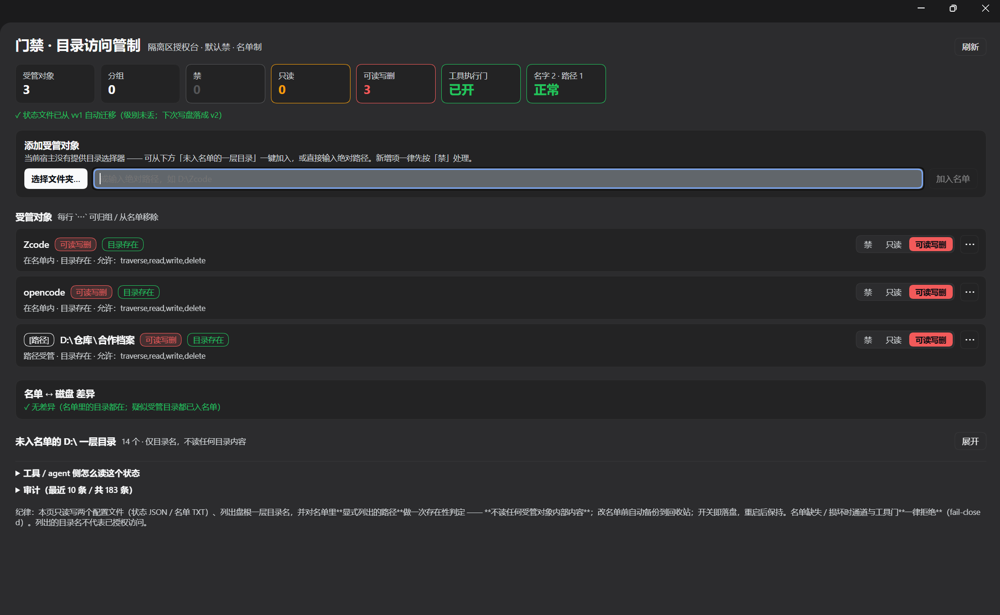

<p align="center"></p>

# 门禁 · dsh-isolation-gate

[](https://www.npmjs.com/package/dsh-isolation-gate)
[](https://www.npmjs.com/package/dsh-isolation-gate)
[](https://github.com/huanlin-labs/dsh-isolation-gate/stargazers)
[](./LICENSE)
[](https://github.com/huanlin-labs/dsh-isolation-gate/actions/workflows/ci.yml)
[](https://nodejs.org)

**给 DeepSeek Harness（DSH）的隔离区授权台：默认禁、名单制、点一下生效、可审计、agent 自己能查。**

[安装](#安装) · [功能](#功能) · [它拦在哪一层](#它拦在哪一层) · [CLI](#命令行--agent-自查) · [English](./README.en.md) · [更新日志](./CHANGELOG.md)

```bash
dsh plugin --profile desktop add dsh-isolation-gate
```

> ⭐ **如果它帮你少踩一次坑，点个 Star 能让更多人找到它** —— 这是这个项目唯一的「传播预算」。
> [](https://github.com/huanlin-labs/dsh-isolation-gate)



---

## 这是什么（以及不是什么）

它不是又一个 allow/deny 规则引擎，也不是沙箱本身。

- **别人按「工具 / 命令 / 参数」立规则**（`dsh-permission-rules`、`dsh-permissions` 这类：allow / deny / ask + glob / 正则）；
- **我们按「目录」立对象**：这台机器上哪些目录属于禁区、现在给什么级别、谁改的、agent 自己怎么查。

规则引擎回答的是「**这次调用准不准**」，门禁回答的是「**这个目录开不开**」。两者可以叠着用，不冲突。

所以它的核心是**管理面**：

| 能力 | 说明 |
|---|---|
| **三级** | `deny` 禁（默认） / `read` 只读 / `full` 可读写删 |
| **两类受管对象** | **名字**（D 根一级目录名，如 `Zcode`）或 **任意绝对路径**（如 `<drive-root>\Zcode`、`E:\资料\合作档案\某项目`） |
| **默认禁 + 名单制** | 只有名单里的对象受管；未列出的不归它管；新增对象一律先按「禁」处理 |
| **一屏开关** | 每个对象一个**分段控件**（禁 / 只读 / 可读写删），点了即落盘，重启后保持 |
| **分组** | 「harness 隔离」「跨家合作」这类命名组；组头一键切三档；组只存在状态文件里，名单仍是"一行一对象" |
| **选择文件夹** | 有原生目录选择器就用它；没有就退回「未入名单的一层目录一键加入 + 文本框」 |
| **两个拦截点** | ① 受管辖通道 `bin/gate.mjs`；② **宿主工具执行门** `ctx.tools.guard()`（2026-10-21 新增） |
| **审计** | `~/.dsh/dsh-isolation-gate/access-log.jsonl`：只记时间/对象/级别/操作/允许与否/理由，**不记文件内容** |
| **agent 自查** | `node bin/gate.mjs status` —— 模型/脚本可以直接读策略，不用猜 |

---

## 它拦在哪一层

```
模型发起工具调用
   │
   ├─ tools/pre-execute  ← ★ 工具执行门（本插件 ctx.tools.guard）
   │      file tools 参数 / shell 命令文本 → 按三级判定 → 拒绝文案回到模型
   │
   ├─ 工具真正执行（read / write / edit / bash …）
   │
   └─ bin/gate.mjs  ← ★ 受管辖通道（agent 显式走它读写受管对象）
          判定不通过 ⇒ 一个字节都不碰
```

两条路都调用**同一个** `checkAccess`，所以面板、CLI、工具门不会说两套话。

---

## 让模型自己管门禁（v1.1+）

插件注册 7 个模型可直接调用的工具，DSH 不必等人点面板：

| 工具 | 作用 | 权限 |
| --- | --- | --- |
| `gate_status` | 看默认级别、受管对象、待批数、授权窗口 | 只读 |
| `gate_check` | 预判某目标某操作会被放行还是拦下 | 只读 |
| `gate_log` | 读最近审计记录 | 只读 |
| `gate_requests` | 看自己提交的待批申请 | 只读 |
| `gate_add` | 把目录/名字纳入受管，**固定为「禁」** | 只收紧 |
| `gate_set_level` | 改级别；**放宽**必须带户主授权窗口 | 收紧可直做 |
| `gate_request` | 提交「想放宽」的待批申请 + 理由 | 申请 |

**不对称规则**：模型能读、能加、能收紧，**不能自己放宽**——放宽只有两条路：

1. 提交 `gate_request` → 户主在「门禁」面板看到待批卡片 → **批准**才生效；
2. 户主主动点「授权 AI 放宽 30 分钟」→ 窗口期内模型可直接放宽，到期自动收回。

没有任何「批准」工具，模型无法自己开门。所有工具调用都进审计日志。

对模型说一句就能用：

> 用 gate_status 看看现在什么被禁；确认 D:\仓库\合作档案 还是禁的话，帮我提个只读申请，理由写"核对合作档案里的结论"。

## 在别的 harness 里用（Claude Code 已支持）

策略引擎是纯 Node、跟 DSH 无关；别的 harness 只多一层**适配器**（读它的事件、喂给同一套判定）。

| harness | 状态 | 怎么接 |
| --- | --- | --- |
| DSH | ✅ 原生 | 装插件（本文其余部分） |
| Claude Code | ✅ v1.3 起 | `PreToolUse` hook → `bin/gate-hook-claude.mjs`，见 [docs/CLAUDE-CODE.md](docs/CLAUDE-CODE.md) |
| opencode | 🧪 v1.4 起（代码+单测通过，未真机验证） | `.opencode/plugins/gate.mjs` 或 `opencode.json` 的 `plugin`；见 [docs/OPENCODE.md](docs/OPENCODE.md) |
| Gemini CLI | 🧪 v1.5 起（代码+单测通过，未真机验证） | `.gemini/settings.json` 的 `BeforeTool` → `bin/gate-hook-gemini.mjs`，见 [docs/GEMINI-CLI.md](docs/GEMINI-CLI.md) |
| 任何支持 MCP 的 harness（Cursor / Windsurf / Codex / Claude Desktop …） | ⚠️ advisory（只能问，不能硬拦） | stdio MCP 服务器 `gate-mcp`，见 [docs/MCP.md](docs/MCP.md) |
| Codex CLI | 🧪 钩子能力随版本变（先自检再接线） | 通用适配器 `gate-hook-generic`，见 [docs/CODEX.md](docs/CODEX.md) |
| 任何「stdin JSON + 退出码」钩子 | ✅ v1.7 起通用 | `gate-hook-generic`（`GATE_DENY_STYLE` 可选 exit2 / json-claude / json-gemini / text），见 [docs/GENERIC-HOOK.md](docs/GENERIC-HOOK.md) | 有工具前置钩子的，照上面两个适配器写一层；只有 MCP 的只能做事前询问，不能硬拦 |

**共用同一份策略**：名单 / 级别 / 审计默认都在 `.agents` 那三个文件里，DSH 面板里改完，Claude Code 下一次工具调用立刻按新级别判。
所有判定都写审计（`channel: hook/claude-code`），所以"谁在什么时候试图碰哪个目录"两边一本账。

**边界（写在前面）**：适配器只管那个 harness 的工具调用——你在终端里手动 `cat` 它不管；`Bash` 只靠命令行里的绝对路径判断，`cd` 后走相对路径会漏判。

## 各 harness 支持度（诚实矩阵）

「门禁」的本质是**执行前拦住**。有没有前置拦截点，决定了它是门禁还是记事本：

| harness | 拦截点 | 能硬拦？ | 验证状态 |
| --- | --- | --- | --- |
| **DSH** | `ctx.tools.guard`（进程内，能看到工具参数） | ✅ | **真机验证**（还有面板 / 7 个工具 / 分组 / 审计，唯一完整形态） |
| **pi** | extension 事件 `tool_call`（`bin/gate-plugin-pi.mjs`，`gate-setup pi` 一条命令接线） | ✅ | 适配器 + 8 条单测；**已真机验证扩展加载与返回形状（pi 1.4.0）**，未跑完整模型循环，见 `docs/PI.md` |
| **Claude Code** | `PreToolUse` hook 返回 deny | ✅ | 单测通过，未真机 |
| **ZCode** | `PreToolUse` → `permissionDecision: deny`（与 Claude Code 同协议，复用同一适配器） | ✅ | 文档逐项对齐，未真机；见 `docs/ZCODE.md` |
| **opencode** | `tool.execute.before` 抛错阻断 | ✅ | 单测通过，未真机 |
| **Gemini CLI** | `BeforeTool` → `decision:deny` | ✅ | 单测通过，未真机 |
| **通用钩子** | 执行前调命令 + stdin 喂 JSON（`gate-hook-generic`） | ✅（前提成立时） | 单测 |
| **MCP 客户端** | 模型**主动**调用 `gate_check` | ❌ **拦不住**，只有建议 + 审计留痕 | 真握手 |
| **Codex** | 钩子随版本（`pre_tool` 或仅 `notify`） | ⚠️ 不确定 | 未验证，见 `docs/CODEX.md` |

**怎么读这张表**：
- 「能硬拦」= 模型即使不想配合也过不去；只有这一类才算门禁。
- MCP 一栏写的是 **advisory**：适合 Cursor / Windsurf / Claude Desktop 这类只有 MCP 的客户端，但它**不能替代**前置钩子，别把它当门禁卖点。
- opencode / Gemini CLI / pi 三家代码或文档已就绪但**没有真机跑过**，标 experimental；真机验证前不要写「支持」。

## 安装

### 路线 A：`dsh plugin add`（推荐，profile 自动追加一行）

```bash
dsh plugin --profile desktop add dsh-isolation-gate
```

> 桌面版（Electron）也可以走「插件」页的**添加插件**，填包名或本地路径。

### 路线 B：profile `link:`（开发/自用）

```jsonc
// ~/.dsh/profiles/<profile>/package.json
"dependencies": { "dsh-isolation-gate": "link:/absolute/path/to/dsh-isolation-gate" }
```

```yaml
# ~/.dsh/profiles/<profile>/cordis.patch.yml
- insert:
    - id: isolation-gate
      name: 'dsh-isolation-gate'
```

⚠️ **改装配 = 要重启 dsh**。**开关本身不需要重启**：改级别、改名单都是即时落盘。

### 零配置默认值

| 配置 | 默认 | 说明 |
|---|---|---|
| `statePath` | `<data-root>/isolation-gate/state.json` | 状态唯一真身 |
| `rosterPath` | `<data-root>/isolation-gate/roster.txt` | 名单（一行一对象） |
| `backupDir` | `<backup-dir>` | 改名单前备份 |
| `root` | `<drive-root>\` | 列"一层目录"的根 |
| `auditPath` | `~\.dsh\dsh-isolation-gate\access-log.jsonl` | 审计 |
| `toolGate` | `true` | 关掉就只剩通道层 |
| `suspectVocabulary` | `['pi','codex',…]` 内置 | 追加"疑似受管目录"名谱（旧键 `harnessVocabulary` 仍读） |

---

## 状态文件（v3）

```jsonc
{
  "version": 3,
  "defaultLevel": "deny",
  "groups": { "harness 隔离": { "note": "", "updatedAt": "…" } },
  "objects": {
    "Zcode": { "level": "deny", "note": "", "group": "harness 隔离", "updatedAt": "…" },
    "E:\\资料\\合作档案\\某项目": { "level": "read", "note": "", "group": "", "updatedAt": "…" }
  },
  "profiles": { "严格交付": { "mode": "allowlist", "allow": [{ "path": "E:\\资料\\库", "level": "read" }], "network": "deny", "unknownTool": "deny" } },
  "sessionOverrides": { "<sessionId>": "严格交付" }
}
```

- **旧格式仍可读**：v1 的 `harnesses: { key: { level } }` 与 v2 的 `objects` 读入时自动收敛成 v3（**级别不丢**，`profiles` / `sessionOverrides` 缺省为空）；下一次写盘才落成 v3。
- 文件缺失 = **全禁**；坏 JSON = **全禁且不覆盖原文件**。
- 无 BOM；写盘走临时文件 + rename（原子替换）。
- `state.harnesses` 在内存里保留为只读别名，磁盘上不再写它。

---

## 判定语义（别改坏）

1. 给路径时先算**真身路径**（目标 realpath，或"最深已存在祖先 realpath + 剩余片段"）⇒ 从别处 junction 绕进来也会被认出来；
2. 在**路径对象**里找**最长前缀命中**（按路径段比较、忽略大小写，`<drive-root>\a\b` 不会命中 `<drive-root>\a\bc`）；
3. 没命中路径对象 ⇒ 退回"盘根一级目录名"匹配**名字对象**；
4. 都不中 ⇒ **不属受管对象**，本通道放行（它只管辖名单内的东西）；
5. **名单缺失 / 读坏 ⇒ 一律拒绝**（fail-closed），不是"放行一切"。

---

## 工具执行门（`ctx.tools.guard`）

- 覆盖：`read / read_image / grep / glob / write / edit / str_replace_editor / apply_patch / mkdir / move / copy / delete / bash / pwsh / …`
- shell 命令会做词法分解：`cd` + 相对路径、重定向、管道、`bash -c "…"` 都会跟进去；
- 未知命令只要命令文本里出现受管绝对路径，就**按写处理**（只在 `full` 放行）——宁可误拒，不可漏放；
- 判定自身抛错 ⇒ **fail-closed**（按拒绝处理）；
- `bin/gate.mjs` 自身的调用**豁免**工具门（它自己会判定，否则会双重拦截）。

---

## CLI（agent / 脚本用）

```bash
node bin/gate.mjs status                       # 全部级别
node bin/gate.mjs policy                       # 紧凑策略行（可塞进提示词）
node bin/gate.mjs check  --name Zcode --op read
node bin/gate.mjs check  --path "<drive-root>\Zcode\某文件" --op delete
node bin/gate.mjs traverse --path "<drive-root>\Zcode"
node bin/gate.mjs read   --path "<drive-root>\Zcode\某文件"
node bin/gate.mjs write  --path "<drive-root>\Zcode\某文件" --text "内容"
node bin/gate.mjs delete --path "<drive-root>\Zcode\某文件"   # 删前自动备份到回收站
node bin/gate.mjs rmdir  --path "<drive-root>\Zcode\空目录"   # 只删空目录（不递归）
node bin/gate.mjs log    --limit 20
```

**退出码**：`0` 放行 / 成功 · `3` 被拒（拒绝文案在 stderr）· `2` 用错或环境错误。

护栏：判定在 I/O 之前；只删文件不删目录；删除前自动备份，备份失败即中止；名单不可用一律拒绝。

---

## HTTP 路由（宿主半 · 本机同源）

| 方法 | 路径 | 作用 |
|---|---|---|
| GET | `/__dsh-isolation-gate/ping` | 身份 + 路由清单 + 能力（`toolGate` / `picker`） |
| GET | `/__dsh-isolation-gate/state` | 全量状态（名单 / 级别 / 分组 / 差异 / 审计 / 策略行） |
| POST | `/__dsh-isolation-gate/level` | `{ name, level }` 改一个对象 |
| POST | `/__dsh-isolation-gate/roster` | `{ action:'add'\|'remove', name }` 名单增删 |
| POST | `/__dsh-isolation-gate/group-level` | `{ group, level }` 组级一键切 |
| POST | `/__dsh-isolation-gate/group` | `{ action:'assign'\|'delete', name?, group }` |
| POST | `/__dsh-isolation-gate/prune` | 清理孤儿键 |
| POST | `/__dsh-isolation-gate/pick` | 调原生目录选择器（无则 400，面板自动走退路） |
| POST | `/__dsh-isolation-gate/toolcheck` | `{ tool, args }` 工具门**干跑**（不执行工具） |
| POST | `/__dsh-isolation-gate/check` | `{ name?\|path?, op }` 判定（不读内容） |
| GET | `/__dsh-isolation-gate/log?limit=` | 最近审计 |

带外部 `Origin` 的请求一律 403；错误方法 405；坏 JSON / 非法级别 400。

---

## 与其它插件的分工

| 插件 | 它管什么 | 与本插件 |
|---|---|---|
| `dsh-house-guard`（本机内建） | **体系资产**：固定几个受保护路径，只有白名单管家会话可写 | 目的不同、对象不重叠；两边都拒则拒（更严者胜） |
| `PerryLink/dsh-permission-rules` | 规则引擎：allow/deny/ask + 工具参数/shell/网络 | **互补**：它没有「只读」这一档；我们的面板不写它的 YAML，**不依赖**它 |
| `cherrchen/dsh-plugin-multi-root-workspace` | 给工作区**加**附加根（只读/读写），靠内核沙箱执行 | **互补**：它是"扩权"，我们是"划禁区"；它强在拦截强度，我们强在管理面与分组 |
| `azazo1/dsh-write-protect` | 工作区内只读保护 + 额外可写根 | 互补；Windows 上它的 bash 侧有明确缺口 |

> 本插件**不声明任何 `@deepseek-ai/dsh*` peer 依赖** —— dsh 升级不会因"版本豁免失效"被静默禁用。

---

## 1.0 的稳定性承诺

从 1.0 起，下面这些**只增不破**；要破坏会走 2.0 并附迁移说明：

| 面 | 承诺 |
|---|---|
| **状态文件** | 磁盘格式 `v3`；v1 / v2 一律**读时兼容、写时升级**，级别不丢。新增字段只追加，不改已有字段含义。 |
| **CLI** | `bin/gate.mjs` 的子命令与退出码（`0` 放行 / `3` 拒绝 / `2` 用错或环境错误）不改；新参数只增加。 |
| **HTTP** | `/__dsh-isolation-gate/*` 现有路径与方法不改；新路由只增加。 |
| **判定语义** | 三级（deny / read / full）、最长前缀命中、默认禁、fail-closed —— 这四项冻结；改它们等于换产品。 |

**不承诺**：面板的视觉与文案、审计日志的字段可以随版本演进；修 bug 不算破坏性变更。

## 已知边界（必须明说）

1. **raw fs 与独立进程拦不住。** 任何程序、脚本、别的 agent 不经过 DSH 工具调用就直接读写磁盘，本插件看不到。
   它拦的是**经过 DSH 的工具调用**与**走 `bin/gate.mjs` 的通道**。
2. **shell 是文本启发式。** 变量间接、命令替换、编码、符号链接、`cmd /c` 套一层等都可能绕过；
   与同类实现同一层级的已知限制。要更强，需要内核沙箱（Windows ACL / Seatbelt / bwrap）。
3. **不是内核级闸门。** 它不修改任何系统 ACL、不接管沙箱。
4. **工具门只覆盖宿主工具。** MCP 工具如果自己开进程读文件，同样只受其参数文本约束。
5. **Windows 优先**：路径比较按 Windows 语义（盘符、`\`、大小写不敏感）；其他平台未验证。

---

## 自测

```bash
node test/run-all.mjs     # 6 个套件 · 396 断言 · 全离线（不需要 GUI/dsh）
node --check lib/*.js
```

| 套件 | 覆盖 |
|---|---|
| `run-data-layer.mjs`（85） | 状态 v1/v2→v3 迁移 / 无 BOM / 坏 JSON 不覆盖 / 路径键 / 名单备份 / 分组 / 孤儿清理 |
| `run-guard.mjs`（74） | 三级×四操作矩阵 / 最长前缀 / 同前缀不误伤 / fail-closed / 真实 I/O 闭环 |
| `run-profiles.mjs`（45） | 隔离强度三档 / 白名单与黑名单语义 / 会话绑定只能加严 / 联网软禁 |
| `run-profiles-runtime.mjs`（11） | 档位文件读取 / 目录绑定 / 坏配置 fail-closed |
| `run-routes.mjs`（84） | 11 条路由 / 组级切 / 工具门挂载与干跑 / 选择器缺省 / 级别落盘 / 403/405/400 |
| `run-client.mjs`（97） | 两座位注册 / 摘要条 / 分组卡片 / 分段控件 / `⋯` 菜单 / 空态 / 交互接线 |

---

## 致谢

- 设计受 `PerryLink/dsh-permission-rules`（Apache-2.0）与 Claude Code `permissions` 的**思路**启发；
  **未复制其任何代码或 README 文字**。
- 与 `@dsh-external/dsh-house-guard` 同机共存，边界见上表。

## 许可

MIT · 见 [LICENSE](./LICENSE)。


---

## 路线图

**已在做 / 下一步**

- [x] 截图四张：总览 / 组卡 / 审计与诊断 / 特别组草稿（见 [docs/screenshots](./docs/screenshots)）
- [ ] 30 秒演示 GIF（欢迎贡献：录你自己机器上的演示；我们不录，整屏会带出无关窗口）
- [ ] **认知帷幕**：受管路径的读取不直接回原文，只回字段摘要或打码内容（群友提的方向；比目录权限更接近「少看一点」）
- [ ] `gate export --csv`：把审计日志导出成表格
- [ ] 临时授权：给某对象一个到期时间，到点自动回到 `deny`
- [ ] 状态文件并发锁（多窗口同时改不互相覆盖）
- [ ] 拒绝原因解释器：告诉模型「是哪条规则、哪段路径命中的」

**明确不做**

- ❌ 内核级沙箱（该交给 Windows ACL / VM）
- ❌ 云端同步 / 账号体系（本插件只认本机状态文件）

有想法请开 [Issue](https://github.com/huanlin-labs/dsh-isolation-gate/issues)，说清处境比说清方案更有用。

---

## 参与

- 装不上 / 不会配 → [Discussions](https://github.com/huanlin-labs/dsh-isolation-gate/discussions)
- 有 Bug → [Bug 报告](https://github.com/huanlin-labs/dsh-isolation-gate/issues/new?template=bug_report.yml)
- 想加功能 → [功能建议](https://github.com/huanlin-labs/dsh-isolation-gate/issues/new?template=feature_request.yml)
- 改代码 → [CONTRIBUTING.md](./CONTRIBUTING.md)（`npm test` 全绿即可提 PR）
- 安全问题 → [SECURITY.md](./SECURITY.md)（不要开公开 Issue）

## Star

如果这个插件帮你避免了一次误删、少配了一次 ACL、或者只是让你看清了「哪些目录其实一直开着」——

**点一下右上角的 ⭐ Star**。它不会改变代码，但会让更多人在搜索 `dsh plugin` 时看到它。

[](https://star-history.com/#huanlin-labs/dsh-isolation-gate&Date)
## 三分钟上手（中文）

见 [docs/QUICKSTART.zh.md](docs/QUICKSTART.zh.md)，或直接：`npx dsh-isolation-gate doctor` 看接线状态。

## 没有前端的 harness 怎么设（ZCode / opencode / pi / Claude Code）

dsh 用户有「门禁」面板；**其它 harness 没有**。所以带了一个本机设置页：

```bash
npx dsh-isolation-gate ui        # 打开 http://127.0.0.1:19390/
```

- 能看到名单里的对象、分组，一键切换 **禁 / 只读 / 可读写删**；
- 能新增对象（名字如 `Zcode`，或绝对路径如 `D:\secret`，默认「禁」）、移出名单；
- 能整组切档；只监听 127.0.0.1，写操作需页面内一次性 token；
- 写的是同一份状态文件（`D:\.agents\门禁-授权.json`），所以 **dsh 面板与其它 harness 共用一套策略**；
- 改完要让对应 harness **新开会话**（ZCode 有 session 快照；其它同理拿最新状态）。

## 支持矩阵（真实验证状态见 [docs/VERIFY.md](docs/VERIFY.md)）

| harness | 拦法 | 硬拦？ |
|---|---|---|
| dsh | 原生工具闸门 | ✅ |
| Claude Code | PreToolUse 钩子 | ✅ |
| ZCode | PreToolUse 钩子 | ✅ |
| opencode | 进程内插件 | ✅ |
| pi | 扩展 tool_call | ✅ |
| Gemini CLI | BeforeTool 钩子 | ✅ |
| Codex CLI | MCP 工具 | ⚠️ advisory（无钩子） |
| Cursor / Windsurf | MCP（`setup mcp`） | ⚠️ advisory |
